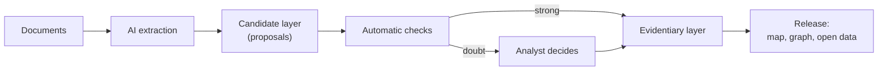

<div align="center">

# Gabriel

**An open-source investigation graph in which every claim carries its source.**

[](https://github.com/gabriel-neutron/GAB/actions/workflows/gates.yml)
[](LICENSE)

[Quick start](#quick-start) · [How it works](#how-it-works) · [Documentation](docs/README.md) ·
[Contributing](CONTRIBUTING.md)

</div>

Gabriel is an OSINT (open-source intelligence) workbench for one analyst. You add documents. AI
agents read them and propose people, companies, vessels, places and the relations between them.
Gabriel checks each proposal against its source, and you decide what becomes evidence. The result
is a graph and a map that you can publish, where each fact links to the passage that states it.

The repository is named `GAB`. The product is named Gabriel.

## Features

- **A source on each claim.** The database refuses a fact that has no source. A reader can go from
  each node, link and value to the passage of the document that states it.
- **Two layers.** The AI writes only proposals. A proposal becomes evidence only by a named rule or
  by the analyst.
- **Review by exception.** Automatic checks accept the strong proposals and stop the weak ones. The
  analyst sees only the doubts.
- **Graph and map.** Explore the entities as a network or on a map, with the source of each item.
- **Static releases.** A release is a dated folder of open files and a static site. Any static host
  can serve it, with no server.
- **An agent toolbox.** An MCP server gives a research AI the tools to search, read sources and
  propose facts.

## How it works



The technical overview is in [`docs/spec.md`](docs/spec.md). The product rules and their reasons
are in [`docs/decisions.md`](docs/decisions.md).

## Quick start

### Requirements

- Node, at the version in `.nvmrc`, and pnpm (run `corepack enable`)
- Docker, for the full stack only
- An [OpenRouter](https://openrouter.ai) key, for the AI jobs only. This key is paid.

### Look at the interface with no backend

The interface can read a release folder in place of a server. The repository holds a sample
release. This mode needs no Docker and no `infra/.env`.

```bash
pnpm install
RELEASE_DIR=packages/site/fixtures/release pnpm dev
```

Open the address that Vite shows, then the Map, Graph or Data tab. The sample release is small. In
PowerShell, set the variable first:
`$env:RELEASE_DIR="packages/site/fixtures/release"`.

### Run the full stack

1. Copy `infra/.env.example` to `infra/.env` and set the values. The raw store keys and the
   operator key are necessary. `infra/README.md` tells how to set them.
2. Start the services: `docker compose -f infra/docker-compose.yml up -d`.
3. Build the database: `pnpm db:migrate`, then `pnpm db:apply`.
4. Start the writer (`pnpm writer`) and the interface (`pnpm dev`).

[`infra/README.md`](infra/README.md) tells what each service does.

### Connect a research AI

The MCP server `gab` gives the research tools to an MCP client such as Claude Code. Its setup is in
[`research/README.md`](research/README.md).

## Project layout

| Folder | Content |
|---|---|
| `src/` | The web interface (React, TanStack Router, MapLibre) |
| `packages/` | The writer, the worker, the MCP server, the tools and the static site |
| `db/` | The database schema and its rules (PostgreSQL, PostGIS) |
| `infra/` | The local services (Docker Compose) |
| `tools/` | The command-line scripts and the database tests |
| `research/` | The shared setup of a research session with an AI agent |
| `docs/` | The product rules, the technical overview and the decision records |

## Development

| Command | Purpose |
|---|---|
| `pnpm check` | Type check, lint and format check |
| `pnpm test:fast` | The tests that need no service |
| `pnpm test` | The full suite. It needs the stack. |
| `pnpm storybook` | The components in isolation |

The project uses AI coding agents. Their shared rules are in `CLAUDE.md`, `.claude/` and
`docs/agents/`. You do not need an agent to contribute. Read [`CONTRIBUTING.md`](CONTRIBUTING.md).

## License

The code is under the [MIT License](LICENSE).
