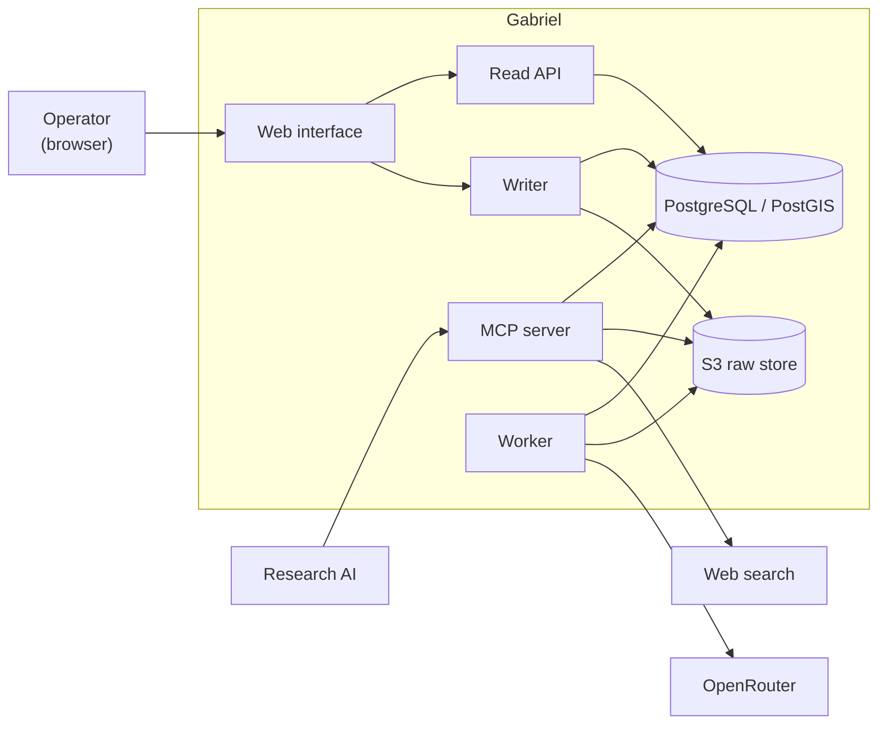

# Gabriel: technical overview

How the parts connect, and which rules hold on every path. The code holds each table, type and
function. `decisions.md` holds the product rules (M8, P1, ...). An ADR holds the reason of a build
choice.

## The parts



- **PostgreSQL / PostGIS:** holds every record and enforces the rules below.
- **S3 raw store:** keeps each original file unchanged, by convention only. Any S3 server works.
- **Writer:** the only write service of the operator. It also shows what the public read hides: job
  status and leads.
- **Read API:** read-only HTTP over a fixed set of public views.
- **Worker:** runs the AI jobs from a queue in the database, and the release command.
- **MCP server:** one flat tool for each action of the research AI. Each tool says if it reads or
  writes.

## Who can do what

| Actor | Can | Cannot |
|---|---|---|
| Operator | Upload, edit, promote, reject, start a lead, merge, undo a merge. | — |
| Research AI | Read the record, proposals, jobs, queue and leads. Fetch, store, propose, queue a job, start a lead. Accept or reject a unit as an AI reviewer. | Decide a unit that the same agent proposed. Merge. Write a table directly. |
| Worker agents | Propose a change with the passage that states it. Rate a new author. For a lead: search, fetch, store, queue an extraction. | Promote. Merge. Start a lead. |
| Public | Read the public views. | Write. |

Each actor has its own database role: the database holds these limits, not the application. The
writer accepts a write or a private read only with the key of the operator, so a machine role
cannot act as the operator through it. The limit: a session that drives the browser of the
operator, or runs code that reads `infra/.env`, is not stopped. `pnpm dev` puts the key in the
address of the browser it opens: rotate the key if it may have leaked.

## Rules that hold on every path

The database enforces each rule with a constraint, a trigger or a permission.

1. Every attribute carries at least one source (M8).
2. Every cited source is a stored document (S2).
3. A machine never signs as the operator (M8).
4. No value is null or blank; the unknown is an absent key (M9).
5. Nothing enters the evidentiary layer without a promotion (P1).
6. Each public decision carries its origin (S4).

## The read path

The interface reads through the read API with a read-only role. Complex reads run as SQL
functions (T4). The public read shows the record and the candidate layer only (PU1): no rejected
proposal, job, lead or model call. It gives the name and version of a rule, never its inputs (S1).

- **Public document:** one that anyone can open at a public address. A file with no address, a
  bought file (a price, or a provider that sells its filings) and an upload stored before the
  address rule are not public.
- **Person:** a fact about a person shows only when one of its sources is a public document. An act
  about a person shows only when each person it names is public. The views apply this rule.
- **Label:** each public claim carries the label of the act that last set it, in the fixed words of
  PU1. The database writes the words, so the API, the screen and an export agree.
- **Merge:** the survivor keeps the identifier of each absorbed entity, so an old link resolves
  (M12, ADR 0014).
- **Cache:** after each write of the operator, each screen reads the record again.

Duplicates wait for the operator in the review page: two vessels with one IMO number, and two
spellings of one name in two scripts (ADR 0022).

## The release path

The operator runs one worker command with a manifest that stays outside the repository. It reads
one snapshot of the record through functions that only tool roles can call, and writes one dated
folder of files, and the site beside it. The site is the application, built once with the files of
the release, and a file for each page. It never writes over an earlier folder (ADR 0013, 0015, 0019,
0028).

- A row is in the release only when it has a public document. A person is in only with a
  designation. A relation is in only when its two ends are. The release holds no candidate.
- Each row carries its label and its licence (the most permissive one among its documents).
- The same rows go out as CSV, GeoJSON and JSON-LD. The manifest gives the size and checksum of each
  file. The changelog compares two release folders.
- No file shows a NATO letter or digit (S1), unless the manifest turns it on.
- A page at a permanent address holds its text in its HTML, so it opens with no script and a
  static host with no rewrite rule serves it. The pages that have no permanent text (the graph, the
  search, the review) need a script.
- No page of the site reads an API. The site reads the files of the release, and it hides each part
  that needs the write service.

## The write path

```
a file → one ingestion door (P6) → raw store + document record + text
       → a job: text file → the extractor proposes claims with checked excerpts
                structured file → a mapping proposal; after promotion, code loads the rows
every unit → the decision rules (S3) → accepted, rejected, waits, or the review queue
the queue  → the operator promotes or rejects (P1) → entities and relations
```

- **Transactions:** a promotion writes the target and marks the proposal accepted in one
  transaction. A rejection writes no target. An edit of the operator is a proposal and its promotion
  in one transaction.
- **One door:** a machine proposes through one batch door. Each act cites a page and a span of
  stored text. The door refuses the whole batch on one fault, and returns a pending act instead of
  a duplicate. The cited passage is private.
- **Check:** before the extractor or the research AI writes, a model of another family checks each
  act against its passage, under a hard token cap. An unsupported act is written as disputed, with
  a private reason. A decided act never changes.
- **Pre-filter:** code drops what a rule can refuse before the door and the checker read it.
- **Day stamp:** a machine door stamps the day of the read. Only the operator door takes an earlier
  day.
- **Unit:** each act gets a unit of decision (P11). An entity is a unit with the relations that
  depend on it. The review queue shows one line for each unit. The acts of one call that name each
  other form a group: a label and a filter, never decided as one block.
- **Promotion:** one unit, in one transaction, or nothing. A relation is written only when each end
  is in the record or in the same unit. A rejection keeps one reason from a fixed list.
- **Group action:** promotes the clean units of one group after one confirmation, parent before
  child. Each unit succeeds or fails on its own.
- **Faults:** one check in the database finds the faults of a list of units. The queue, the
  promotion and the group action read it. A fault blocks, makes a unit not clean, or only informs.
- **Rejected claim:** each act keeps a frozen key of its claim. A unit with the key of a rejected
  act is not clean.

## The decision path

```
a new author name → a model joins it to a known author, or rates it C to F (S1)
a unit            → the rules of S3, in order, from the letters and the checks
                      impossible → rejected      doubt → the review queue
                      strong sources → accepted
                      weak sources → waits; a deepening search may run (P10)
```

The database applies the rules, so each writer gets the same decision. A decision records the name
and version of its rule (or "validated manually", or "decided by an AI reviewer") and the inputs
that the rule read (S4). A model never writes a state. Code computes the digit of a fact from its
independent authors and conflicts. Only the approved reference set holds A and B. A source A counts
alone only on a site of its author.

## The lead path

A lead is a short text from the operator or the research AI. It becomes a job. The lead agent
searches, fetches and stores each new page, and queues its extraction. It proposes nothing and
starts no lead. A token budget stops it. A deepening search starts only for a unit with weak
sources, inside the budget of the operator, and never from a page of another deepening search. No
schedule starts a lead. The text of a lead is private.

## Technical baseline

| ID | Decision |
|---|---|
| T1 | TypeScript end to end. |
| T2 | PostgreSQL/PostGIS is the single datastore. |
| T3 | The raw file is in S3; the processed data is in PostgreSQL. |
| T4 | The interface reads by itself; the backend serves writes only. |
| T5 | pgvector and a job table; no vector database, no message queue. |
| T6 | Zod reads the shape of a request. The database holds each rule on data. |

Set an operational value (a threshold, a radius, a zoom level) from real data, in configuration,
never as a code constant.
