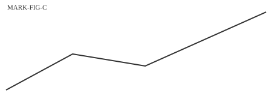
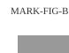

## 1. Résumé

Le port de Brumel reçoit 1 200 navires par an ; la moitié ne dépose aucune déclaration préalable. Cette lecture est Probable [À CONFIRMER: mesure ADMIRALTY], car elle repose sur un seul registre.[^a] Un second chiffre est Établi : le quai nord reste fermé depuis mars (figure 1).[^b] Les données sont publiées à l'adresse [LIEN JEU DE DONNÉES].

> **Appréciation · probable (55–75 %) · confiance moyenne**
> Les auteurs jugent que la fermeture du quai nord explique la baisse des escales.

## 2. Contexte

Le registre du port compte 1 200 escales en 2026, contre 1 450 en 2025.[^c] Une partie des données est Indicatif seulement [À STOCKER: série mensuelle des escales].[^b]

**Figure 1.** Escales annuelles du port de Brumel, 2020-2026 (nombre de navires). Source : registre du port, doc_0123456789ab. Note : le graphique montre les escales commerciales ; la série ne commence pas à zéro.

Le tableau suivant donne les instruments de contrôle (tableau 1).

Tableau 1. Les instruments de contrôle du port, dates portées par l'acte. Source : journal officiel imaginaire. Note : état au 1er janvier 2027.

| Acte | Date | Objet | Nombre |
|---|---|---|---|
| Arrêté 2020/1, art. 3 | 2020-03-01 | Déclaration préalable | 1 200 |
| Arrêté 2021/9, art. 1 | 2021-06-15 | Quai nord | 35,5 % |
| Arrêté 2022/4 | 2022-01-10 | Pilotage obligatoire | – |

**Encadré B1. Un prix de référence.** Le droit de port est de 12 euros la tonne ; il n'a pas changé depuis 2019.[^c]

## 3. Méthode

Un chiffre est Non établi lorsqu'aucune source stockée ne le porte. L'auteur écrit « établi » seulement avec deux sources.

Figure 2. Deux vues du même quai, tonnage et surface (tonnes ; mètres carrés). Sources : registre du port ; relevé inventé. Note : les deux vues ont la même échelle.

## 4. Importations

**À écrire par le co-auteur.**

Page réservée.

## Financement

This investigation was supported by FNF through the OSINT+ Investigation Competition 2026. The author(s) are solely responsible for the content and conclusions presented.

## Sources par note

[^a]: Registre du port de Brumel, 2026, p. 3 ; doc_0123456789ab ; Confiance : Probable.
[^b]: Arrêté 2021/9 ; doc_abcdef012345 ; texte juridique ; Confiance : Établi.
[^c]: Rapport annuel du port, 2026 ; doc_111111111111 ; Confiance : Indicatif.
